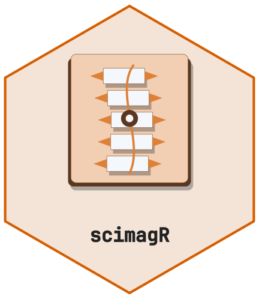

# Getting Started with scimagR



[](https://github.com/CTTIR/scimagR/actions/workflows/R-CMD-check.yaml)
[](https://cttir.github.io/scimagR/)
[](https://CRAN.R-project.org/package=scimagR)
[](https://app.codecov.io/gh/CTTIR/scimagR?branch=main)
[](https://cran.r-project.org/package=scimagR)
[](https://cran.r-project.org/package=scimagR)
[](https://opensource.org/licenses/MIT)
[](https://lifecycle.r-lib.org/articles/stages.html#experimental)

## Overview

scimagR provides the building blocks of a longitudinal MRI and CT
analysis in spinal cord injury (SCI) research. This vignette walks you
through:

1.  Installing prerequisites
2.  Creating a new project
3.  Organising your data
4.  Planning the processing steps
5.  Computing metrics and plotting results

All code below runs without the external imaging tools, on synthetic
data and in a temporary folder, except the tool checks in the next
section.

## Prerequisites

The image-processing wrappers need the following external tools. They
are optional: the metrics, registry, quality-control and plotting
functions work without them.

- **Spinal Cord Toolbox (SCT)** \>= 6.4: <https://spinalcordtoolbox.com>
  (SCT 6 and SCT 7 command syntax are both supported)
- **dcm2niix**: <https://github.com/rordenlab/dcm2niix>
- **Python 3** with pydicom: `pip install pydicom`

Check that all tools are available:

``` r

library(scimagR)

check_sct()
check_dcm2niix()
check_pydicom()
```

## Creating a Project

Use
[`sci_create_project()`](https://cttir.github.io/scimagR/reference/sci_create_project.md)
to scaffold a new workflowr-based analysis project. Here it is created
in a temporary folder; use a permanent path such as
`"~/projects/my-sci-study"` for real work.

``` r

library(scimagR)

proj <- file.path(tempdir(), "my-sci-study")
sci_create_project(
  path = proj,
  title = "Cervical SCI Longitudinal MRI Analysis",
  author = "Your Name",
  open = FALSE
)
#> 
#> ── Creating SCI project: Cervical SCI Longitudinal MRI Analysis ────────────────
#> ✔ Directory structure created.
#> ✔ Templates created.
#> ✔ Project created at /tmp/Rtmpud1jXj/my-sci-study
#> ℹ Next steps:
#>   1. Place DICOM files in data/raw/dicom/
#>   2. Fill in data/metadata/imaging_registry.csv
#>   3. Fill in data/metadata/clinical_data.csv
#>   4. Plan the processing steps with `sci_run_pipeline()`
list.files(proj)
#> [1] "analysis"   "code"       "data"       "manuscript" "results"   
#> [6] "scripts"
```

This creates a complete directory structure with template files,
configuration, and analysis Rmd notebooks.

## Data Organisation

Place your DICOM files in `data/raw/dicom/` following this structure:

    data/raw/dicom/
    ├── SCI001/
    │   ├── ses-01/
    │   │   └── *.dcm
    │   └── ses-02/
    │       └── *.dcm
    └── SCI002/
        └── ses-01/
            └── *.dcm

Fill in the CSV templates in `data/metadata/`:

- `imaging_registry.csv`: One row per imaging session
- `clinical_data.csv`: One row per patient

## Planning the Processing Steps

[`sci_run_pipeline()`](https://cttir.github.io/scimagR/reference/sci_run_pipeline.md)
is a planner: it lists the eight processing steps and the function that
performs each one. It does **not** run the Spinal Cord Toolbox,
‘dcm2niix’ or ‘pydicom’ and does not check what has been done, so every
step is reported as `"pending"` (step 2, anonymisation, as `"skipped"`
unless `anonymize = TRUE`).

``` r

plan <- sci_run_pipeline(proj, verbose = FALSE)
plan
#> # A tibble: 8 × 4
#>    step name                           status  message                          
#>   <int> <chr>                          <chr>   <chr>                            
#> 1     1 DICOM metadata extraction      pending run extract_dicom_metadata()     
#> 2     2 Anonymisation                  skipped anonymize = FALSE                
#> 3     3 DICOM to NIfTI conversion      pending run convert_batch()              
#> 4     4 Spinal cord segmentation       pending run sct_segment_sc()             
#> 5     5 Lesion segmentation (SCIsegV2) pending run sct_segment_lesion()         
#> 6     6 Vertebral labelling            pending run sct_label_vertebrae()        
#> 7     7 Parameter extraction           pending run sct_analyze_lesion() and sct…
#> 8     8 Merge & export                 pending run save_table() and save_rds()
```

Run the function named in each row (see
[`vignette("sct-interface")`](https://cttir.github.io/scimagR/articles/sct-interface.md)),
then check which outputs exist with
[`sci_pipeline_status()`](https://cttir.github.io/scimagR/reference/sci_pipeline_status.md).
It scans `data/nifti/<pat_id>/<session>/`; a new project has no sessions
yet:

``` r

sci_pipeline_status(proj)
#> # A tibble: 0 × 8
#> # ℹ 8 variables: pat_id <chr>, session <chr>, converted <lgl>, sc_seg <lgl>,
#> #   lesion_seg <lgl>, vert_labels <lgl>, qc_done <lgl>, params_extracted <lgl>
```

## Computing SCI Metrics

scimagR implements common SCI metrics. They are vectorised, so they can
be used inside
[`dplyr::mutate()`](https://dplyr.tidyverse.org/reference/mutate.html):

``` r

# Maximum spinal cord compression (Fehlings et al. 1999)
compute_mscc(di = 5.2, da = 8.1, db = 8.5)
#> [1] 37.3494

# Anteroposterior compression ratio (Ogino et al. 1983)
compute_compression_ratio(ap = 6.5, transverse = 12.0)
#> [1] 0.5416667

# Phase classification
classify_phase(c(0, 5, 30, 200, 400))
#> [1] hyperacute   acute        subacute     intermediate chronic     
#> Levels: hyperacute < acute < subacute < intermediate < chronic
```

## Working with the Registry

The package ships a synthetic example registry with three patients:

``` r

reg <- validate_registry(
  system.file("extdata", "example_registry.csv", package = "scimagR")
)
#> ✔ Registry validation passed.
coverage_matrix(reg)
#> # A tibble: 3 × 4
#>   pat_id `ses-01` `ses-02` `ses-03`
#>   <chr>  <chr>    <chr>    <chr>   
#> 1 SCI001 MRT      MRT      MRT     
#> 2 SCI002 CT+MRT   MRT      NA      
#> 3 SCI003 CT       MRT      MRT
```

## Visualisation

Use the built-in theme, palettes and plot types for publication-ready
figures. The coverage plot shows which modality each patient has at each
session, with the artefact grade printed on the tile:

``` r

plot_coverage(reg)
```


Synthetic MSCC values by phase:

``` r

set.seed(42)
mscc_data <- data.frame(
  phase = factor(rep(c("acute", "subacute", "chronic"), each = 15),
                 levels = c("acute", "subacute", "chronic")),
  mscc = c(rnorm(15, 30, 8), rnorm(15, 22, 6), rnorm(15, 15, 5))
)
plot_violin_box(mscc_data, x = "phase", y = "mscc", ylab = "MSCC (%)")
```


