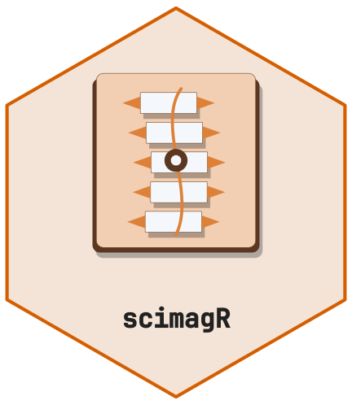

# Pipeline Walkthrough



[](https://github.com/CTTIR/scimagR/actions/workflows/R-CMD-check.yaml)
[](https://cttir.github.io/scimagR/)
[](https://CRAN.R-project.org/package=scimagR)
[](https://app.codecov.io/gh/CTTIR/scimagR?branch=main)
[](https://cran.r-project.org/package=scimagR)
[](https://cran.r-project.org/package=scimagR)
[](https://opensource.org/licenses/MIT)
[](https://lifecycle.r-lib.org/articles/stages.html#experimental)

## Overview

The SCI imaging workflow has 8 sequential steps, each performed by its
own function (Spinal Cord Toolbox, ‘dcm2niix’ and ‘pydicom’ wrappers).
[`sci_run_pipeline()`](https://cttir.github.io/scimagR/reference/sci_run_pipeline.md)
checks the project and returns this plan, naming the function to run for
every requested step.

[`sci_run_pipeline()`](https://cttir.github.io/scimagR/reference/sci_run_pipeline.md)
is a planner, not a runner:

- it does **not** call any external tool and does not read or write
  images;
- it does **not** look at existing outputs, so every requested step is
  `"pending"` (step 2 is `"skipped"` unless `anonymize = TRUE`);
- [`sci_pipeline_status()`](https://cttir.github.io/scimagR/reference/sci_pipeline_status.md)
  is the function that reports what exists on disk.

The code in this vignette runs on a temporary project and the synthetic
example registry; nothing here needs the external tools.

## Pipeline Steps

| Step | Name | Function | Tool | Output |
|----|----|----|----|----|
| 1 | DICOM metadata extraction | [`extract_dicom_metadata()`](https://cttir.github.io/scimagR/reference/extract_dicom_metadata.md) | pydicom | metadata CSV |
| 2 | Anonymisation (optional) | [`anonymize_dicom()`](https://cttir.github.io/scimagR/reference/anonymize_dicom.md) | pydicom | anonymised DICOMs + mapping |
| 3 | DICOM to NIfTI conversion | [`convert_batch()`](https://cttir.github.io/scimagR/reference/convert_batch.md) | dcm2niix | .nii.gz files |
| 4 | Spinal cord segmentation | [`sct_segment_sc()`](https://cttir.github.io/scimagR/reference/sct_segment_sc.md) | SCT | `_seg.nii.gz` |
| 5 | Lesion segmentation | [`sct_segment_lesion()`](https://cttir.github.io/scimagR/reference/sct_segment_lesion.md) | SCT (SCIsegV2) | `_lesion_seg.nii.gz`, `_sc_seg.nii.gz` |
| 6 | Vertebral labelling | [`sct_label_vertebrae()`](https://cttir.github.io/scimagR/reference/sct_label_vertebrae.md) | SCT | `_seg_labeled.nii.gz` |
| 7 | Parameter extraction | [`sct_analyze_lesion()`](https://cttir.github.io/scimagR/reference/sct_analyze_lesion.md), [`sct_process_segmentation()`](https://cttir.github.io/scimagR/reference/sct_process_segmentation.md) | SCT | `_analysis.xlsx`, `_csa.csv` |
| 8 | Merge & export | [`save_table()`](https://cttir.github.io/scimagR/reference/save_table.md), [`save_rds()`](https://cttir.github.io/scimagR/reference/save_rds.md) | R | combined dataset |

## Planning the Pipeline

``` r

library(scimagR)

proj <- file.path(tempdir(), "walkthrough-study")
sci_create_project(proj, open = FALSE)
#> 
#> ── Creating SCI project: SCI Imaging Analysis ──────────────────────────────────
#> ✔ Directory structure created.
#> ✔ Templates created.
#> ✔ Project created at /tmp/Rtmpae89hT/walkthrough-study
#> ℹ Next steps:
#>   1. Place DICOM files in data/raw/dicom/
#>   2. Fill in data/metadata/imaging_registry.csv
#>   3. Fill in data/metadata/clinical_data.csv
#>   4. Plan the processing steps with `sci_run_pipeline()`

status <- sci_run_pipeline(
  project_dir = proj,
  steps = 1:8,
  anonymize = FALSE
)
#> 
#> ── Step 1: DICOM metadata extraction ──
#> 
#> ℹ Run `extract_dicom_metadata()` for this step.
#> Step 2 (Anonymisation): skipped (anonymize = FALSE)
#> ── Step 3: DICOM to NIfTI conversion ──
#> 
#> ℹ Run `convert_batch()` for this step.
#> 
#> ── Step 4: Spinal cord segmentation ──
#> 
#> ℹ Run `sct_segment_sc()` for this step.
#> 
#> ── Step 5: Lesion segmentation (SCIsegV2) ──
#> 
#> ℹ Run `sct_segment_lesion()` for this step.
#> ! QC PAUSE: review the lesion segmentations before steps 6-8.
#> Check the QC reports (`qc_dir` or `sct_generate_qc()`).
#> ── Step 6: Vertebral labelling ──
#> 
#> ℹ Run `sct_label_vertebrae()` for this step.
#> 
#> ── Step 7: Parameter extraction ──
#> 
#> ℹ Run `sct_analyze_lesion() and sct_process_segmentation()` for this step.
#> 
#> ── Step 8: Merge & export ──
#> 
#> ℹ Run `save_table() and save_rds()` for this step.
#> 
#> ── Pipeline Summary ──
#> 
#> 7 pending, 1 skipped
status
#> # A tibble: 8 × 4
#>    step name                           status  message                          
#>   <int> <chr>                          <chr>   <chr>                            
#> 1     1 DICOM metadata extraction      pending run extract_dicom_metadata()     
#> 2     2 Anonymisation                  skipped anonymize = FALSE                
#> 3     3 DICOM to NIfTI conversion      pending run convert_batch()              
#> 4     4 Spinal cord segmentation       pending run sct_segment_sc()             
#> 5     5 Lesion segmentation (SCIsegV2) pending run sct_segment_lesion()         
#> 6     6 Vertebral labelling            pending run sct_label_vertebrae()        
#> 7     7 Parameter extraction           pending run sct_analyze_lesion() and sct…
#> 8     8 Merge & export                 pending run save_table() and save_rds()
```

## Planning Individual Steps

Plan only specific steps by setting the `steps` argument, then run the
function each row names:

``` r

# Just the DICOM conversion
sci_run_pipeline(proj, steps = 3, verbose = FALSE)
#> # A tibble: 1 × 4
#>    step name                      status  message            
#>   <int> <chr>                     <chr>   <chr>              
#> 1     3 DICOM to NIfTI conversion pending run convert_batch()

# The segmentation steps
sci_run_pipeline(proj, steps = 4:5, verbose = FALSE)
#> # A tibble: 2 × 4
#>    step name                           status  message                 
#>   <int> <chr>                          <chr>   <chr>                   
#> 1     4 Spinal cord segmentation       pending run sct_segment_sc()    
#> 2     5 Lesion segmentation (SCIsegV2) pending run sct_segment_lesion()
```

## The QC Pause

After step 5 (lesion segmentation), stop for manual QC before steps 6–8.
This is critical: automated lesion segmentation must be visually
verified before extracting quantitative parameters. The plan reminds you
of it:

``` r

invisible(sci_run_pipeline(proj, steps = 5))
#> 
#> ── Step 5: Lesion segmentation (SCIsegV2) ──
#> 
#> ℹ Run `sct_segment_lesion()` for this step.
#> ! QC PAUSE: review the lesion segmentations before steps 6-8.
#> Check the QC reports (`qc_dir` or `sct_generate_qc()`).
#> 
#> 
#> ── Pipeline Summary ──
#> 
#> 
#> 
#> 1 pending, 0 skipped
```

During the QC pause:

1.  Open the QC HTML reports (written to `qc_dir` of
    [`sct_segment_lesion()`](https://cttir.github.io/scimagR/reference/sct_segment_lesion.md)
    or by
    [`sct_generate_qc()`](https://cttir.github.io/scimagR/reference/sct_generate_qc.md)),
    for example in `data/qc/`
2.  Grade each segmentation in the QC log
3.  Re-run failed segmentations if needed
4.  Continue with steps 6–8

## Checking Pipeline Status

[`sci_pipeline_status()`](https://cttir.github.io/scimagR/reference/sci_pipeline_status.md)
scans `data/nifti/<pat_id>/<session>/` for the files the steps write.
Here two sessions are mocked with empty files:

``` r

ses1 <- file.path(proj, "data", "nifti", "SCI001", "ses-01")
ses2 <- file.path(proj, "data", "nifti", "SCI001", "ses-02")
dir.create(ses1, recursive = TRUE)
dir.create(ses2, recursive = TRUE)
file.create(file.path(ses1, c("t2.nii.gz", "t2_seg.nii.gz",
                              "t2_lesion_seg.nii.gz",
                              "t2_seg_labeled.nii.gz")))
#> [1] TRUE TRUE TRUE TRUE
file.create(file.path(ses2, "t2.nii.gz"))
#> [1] TRUE

sci_pipeline_status(proj)
#> # A tibble: 2 × 8
#>   pat_id session converted sc_seg lesion_seg vert_labels qc_done
#>   <chr>  <chr>   <lgl>     <lgl>  <lgl>      <lgl>       <lgl>  
#> 1 SCI001 ses-01  TRUE      TRUE   TRUE       TRUE        FALSE  
#> 2 SCI001 ses-02  TRUE      FALSE  FALSE      FALSE       FALSE  
#> # ℹ 1 more variable: params_extracted <lgl>
```

This returns a tibble showing which outputs exist for each patient and
session.

## Artefact Grading Strategy

After visual QC, assign artefact grades (0-4) in the imaging registry:

- **0 (none)**: Perfect image quality
- **1 (mild)**: Minor artefacts, measurements reliable
- **2 (moderate)**: Visible artefacts, measurements acceptable
- **3 (severe)**: Major artefacts, measurements unreliable
- **4 (non-evaluable)**: Cannot be analysed

Use
[`filter_evaluable()`](https://cttir.github.io/scimagR/reference/filter_evaluable.md)
to exclude sessions with grade \> 2, and
[`log_exclusion()`](https://cttir.github.io/scimagR/reference/log_exclusion.md)
to record each step for a flow diagram:

``` r

registry <- validate_registry(
  system.file("extdata", "example_registry.csv", package = "scimagR")
)
#> ✔ Registry validation passed.
evaluable <- filter_evaluable(registry, max_artifact = 1)
#> Filtered: 8 -> 6 (2 excluded)
log_exclusion("Artefact grade <= 1, MRI", nrow(registry), nrow(evaluable),
              "artifact_grade > 1 or CT only")
#> # A tibble: 1 × 5
#>   step                     n_before n_after n_excluded reason                   
#>   <chr>                       <int>   <int>      <int> <chr>                    
#> 1 Artefact grade <= 1, MRI        8       6          2 artifact_grade > 1 or CT…
```

## Coverage Matrix

After processing, check your data coverage:

``` r

plot_coverage(registry)
```


This tile plot shows which modalities are available for each patient at
each time point, with artefact grades overlaid.

## Resuming After Interruption

Because
[`sci_run_pipeline()`](https://cttir.github.io/scimagR/reference/sci_run_pipeline.md)
does not track progress, use
[`sci_pipeline_status()`](https://cttir.github.io/scimagR/reference/sci_pipeline_status.md)
after an interruption to see where to continue, and re-run the step
functions: the SCT wrappers skip work whose output file already exists
(unless `overwrite = TRUE`).
