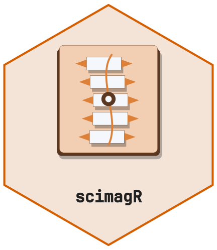
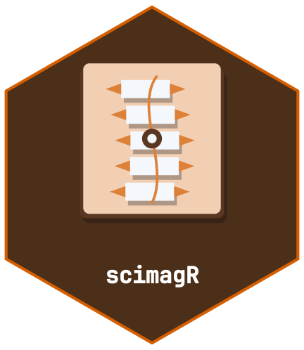

<!-- cttir-vignette-logo: start -->
<style>
.cttir-vignette-logo { float: right; width: 120px; max-width: 30%; margin: 0 0 1rem 1.5rem; }
.cttir-vignette-logo img { width: 100%; height: auto; border: 0; background: transparent; box-shadow: none; }
.cttir-vignette-logo .cttir-vignette-logo-light { display: block; }
.cttir-vignette-logo .cttir-vignette-logo-dark { display: none; }
@media (prefers-color-scheme: dark) {
  .cttir-vignette-logo .cttir-vignette-logo-light { display: none; }
  .cttir-vignette-logo .cttir-vignette-logo-dark { display: block; }
}
[data-bs-theme="light"] .cttir-vignette-logo .cttir-vignette-logo-light { display: block; }
[data-bs-theme="light"] .cttir-vignette-logo .cttir-vignette-logo-dark { display: none; }
[data-bs-theme="dark"] .cttir-vignette-logo .cttir-vignette-logo-light { display: none; }
[data-bs-theme="dark"] .cttir-vignette-logo .cttir-vignette-logo-dark { display: block; }
</style>
<div class="cttir-vignette-logo">
  
  
</div>
<!-- cttir-vignette-logo: end -->

<!-- badges: start -->
[](https://github.com/CTTIR/scimagR/actions/workflows/R-CMD-check.yaml)
[](https://cttir.github.io/scimagR/)
[](https://CRAN.R-project.org/package=scimagR)
[](https://app.codecov.io/gh/CTTIR/scimagR?branch=main)
[](https://cran.r-project.org/package=scimagR)
[](https://cran.r-project.org/package=scimagR)
[](https://opensource.org/licenses/MIT)
[](https://lifecycle.r-lib.org/articles/stages.html#experimental)
<!-- badges: end -->

```{r setup, include = FALSE}
knitr::opts_chunk$set(
  collapse = TRUE,
  comment = "#>",
  eval = FALSE
)
```

## Overview

The SCI imaging workflow has 8 sequential steps, each performed by its own
function (Spinal Cord Toolbox, 'dcm2niix' and 'pydicom' wrappers).
`sci_run_pipeline()` checks the project and returns this plan, naming the
function to run for every requested step; it does not run the external tools
itself, so each step is reported as `"pending"`.

## Pipeline Steps

| Step | Name | Tool | Output |
|------|------|------|--------|
| 1 | DICOM metadata extraction | pydicom | metadata CSV |
| 2 | Anonymization (optional) | pydicom | anonymized DICOMs + mapping |
| 3 | DICOM to NIfTI conversion | dcm2niix | .nii.gz files |
| 4 | Spinal cord segmentation | SCT | _seg.nii.gz |
| 5 | Lesion segmentation | SCT (SCIsegV2) | _lesion_seg.nii.gz |
| 6 | Vertebral labeling | SCT | _labels-disc.nii.gz |
| 7 | Parameter extraction | SCT | CSVs with metrics |
| 8 | Merge & export | R | combined dataset |

## Planning the Pipeline

```{r full-pipeline}
library(scimagR)

status <- sci_run_pipeline(
  project_dir = "~/projects/my-sci-study",
  steps = 1:8,
  anonymize = FALSE
)
```

## Running Individual Steps

Plan only specific steps by setting the `steps` argument, then run the
function each row names:

```{r partial}
# Just the DICOM conversion
sci_run_pipeline("~/projects/my-sci-study", steps = 3)

# The segmentation steps
sci_run_pipeline("~/projects/my-sci-study", steps = 4:5)
```

## The QC Pause

After Step 5 (lesion segmentation), the pipeline pauses for manual QC.
This is critical: automated lesion segmentation must be visually verified
before extracting quantitative parameters.

During the QC pause:

1. Open the QC HTML reports in `data/qc/`
2. Grade each segmentation in the QC log
3. Re-run failed segmentations if needed
4. Continue with steps 6-8

## Checking Pipeline Status

```{r status}
sci_pipeline_status("~/projects/my-sci-study")
```

This returns a tibble showing which steps are complete for each
patient and session.

## Artifact Grading Strategy

After visual QC, assign artifact grades (0-4) in the imaging registry:

- **0 (none)**: Perfect image quality
- **1 (mild)**: Minor artifacts, measurements reliable
- **2 (moderate)**: Visible artifacts, measurements acceptable
- **3 (severe)**: Major artifacts, measurements unreliable
- **4 (non-evaluable)**: Cannot be analyzed

Use `filter_evaluable()` to exclude sessions with grade > 2:

```{r filter}
evaluable <- filter_evaluable(registry, max_artifact = 2)
```

## Coverage Matrix

After processing, check your data coverage:

```{r coverage}
plot_coverage(registry)
```

This tile plot shows which modalities are available for each patient
at each timepoint, with artifact grades overlaid.

## Resuming After Interruption

`sci_pipeline_status()` scans the project for existing outputs, so after an
interruption it shows where to continue:

```{r resume}
sci_pipeline_status("~/projects/my-sci-study")
```
