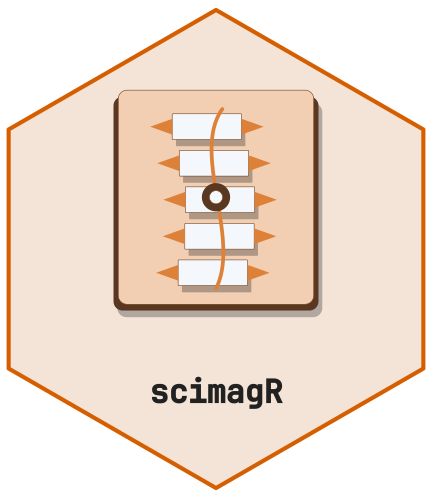

<!-- cttir-vignette-logo: start -->
<style>
.cttir-vignette-logo { float: right; width: 120px; max-width: 30%; margin: 0 0 1rem 1.5rem; }
.cttir-vignette-logo img { width: 100%; height: auto; border: 0; background: transparent; box-shadow: none; }
.cttir-vignette-logo .cttir-vignette-logo-light { display: block; }
.cttir-vignette-logo .cttir-vignette-logo-dark { display: none; }
@media (prefers-color-scheme: dark) {
  .cttir-vignette-logo .cttir-vignette-logo-light { display: none; }
  .cttir-vignette-logo .cttir-vignette-logo-dark { display: block; }
}
[data-bs-theme="light"] .cttir-vignette-logo .cttir-vignette-logo-light { display: block; }
[data-bs-theme="light"] .cttir-vignette-logo .cttir-vignette-logo-dark { display: none; }
[data-bs-theme="dark"] .cttir-vignette-logo .cttir-vignette-logo-light { display: none; }
[data-bs-theme="dark"] .cttir-vignette-logo .cttir-vignette-logo-dark { display: block; }
</style>
<div class="cttir-vignette-logo">
  
  
</div>
<!-- cttir-vignette-logo: end -->

<!-- badges: start -->
[](https://github.com/CTTIR/scimagR/actions/workflows/R-CMD-check.yaml)
[](https://cttir.github.io/scimagR/)
[](https://CRAN.R-project.org/package=scimagR)
[](https://app.codecov.io/gh/CTTIR/scimagR?branch=main)
[](https://cran.r-project.org/package=scimagR)
[](https://cran.r-project.org/package=scimagR)
[](https://opensource.org/licenses/MIT)
[](https://lifecycle.r-lib.org/articles/stages.html#experimental)
<!-- badges: end -->

```{r setup, include = FALSE}
knitr::opts_chunk$set(
  collapse = TRUE,
  comment = "#>",
  fig.width = 6,
  fig.height = 4,
  dpi = 96
)
```

## Overview

The SCI imaging workflow has 8 sequential steps, each performed by its own
function (Spinal Cord Toolbox, 'dcm2niix' and 'pydicom' wrappers).
`sci_run_pipeline()` checks the project and returns this plan, naming the
function to run for every requested step.

`sci_run_pipeline()` is a planner, not a runner:

- it does **not** call any external tool and does not read or write images;
- it does **not** look at existing outputs, so every requested step is
  `"pending"` (step 2 is `"skipped"` unless `anonymize = TRUE`);
- `sci_pipeline_status()` is the function that reports what exists on disk.

The code in this vignette runs on a temporary project and the synthetic
example registry; nothing here needs the external tools.

## Pipeline Steps

| Step | Name | Function | Tool | Output |
|------|------|----------|------|--------|
| 1 | DICOM metadata extraction | `extract_dicom_metadata()` | pydicom | metadata CSV |
| 2 | Anonymisation (optional) | `anonymize_dicom()` | pydicom | anonymised DICOMs + mapping |
| 3 | DICOM to NIfTI conversion | `convert_batch()` | dcm2niix | .nii.gz files |
| 4 | Spinal cord segmentation | `sct_segment_sc()` | SCT | `_seg.nii.gz` |
| 5 | Lesion segmentation | `sct_segment_lesion()` | SCT (SCIsegV2) | `_lesion_seg.nii.gz`, `_sc_seg.nii.gz` |
| 6 | Vertebral labelling | `sct_label_vertebrae()` | SCT | `_seg_labeled.nii.gz` |
| 7 | Parameter extraction | `sct_analyze_lesion()`, `sct_process_segmentation()` | SCT | `_analysis.xlsx`, `_csa.csv` |
| 8 | Merge & export | `save_table()`, `save_rds()` | R | combined dataset |

## Planning the Pipeline

```{r full-pipeline}
library(scimagR)

proj <- file.path(tempdir(), "walkthrough-study")
sci_create_project(proj, open = FALSE)

status <- sci_run_pipeline(
  project_dir = proj,
  steps = 1:8,
  anonymize = FALSE
)
status
```

## Planning Individual Steps

Plan only specific steps by setting the `steps` argument, then run the
function each row names:

```{r partial}
# Just the DICOM conversion
sci_run_pipeline(proj, steps = 3, verbose = FALSE)

# The segmentation steps
sci_run_pipeline(proj, steps = 4:5, verbose = FALSE)
```

## The QC Pause

After step 5 (lesion segmentation), stop for manual QC before steps 6--8.
This is critical: automated lesion segmentation must be visually verified
before extracting quantitative parameters. The plan reminds you of it:

```{r qc-pause}
invisible(sci_run_pipeline(proj, steps = 5))
```

During the QC pause:

1. Open the QC HTML reports (written to `qc_dir` of `sct_segment_lesion()`
   or by `sct_generate_qc()`), for example in `data/qc/`
2. Grade each segmentation in the QC log
3. Re-run failed segmentations if needed
4. Continue with steps 6--8

## Checking Pipeline Status

`sci_pipeline_status()` scans `data/nifti/<pat_id>/<session>/` for the files
the steps write. Here two sessions are mocked with empty files:

```{r status}
ses1 <- file.path(proj, "data", "nifti", "SCI001", "ses-01")
ses2 <- file.path(proj, "data", "nifti", "SCI001", "ses-02")
dir.create(ses1, recursive = TRUE)
dir.create(ses2, recursive = TRUE)
file.create(file.path(ses1, c("t2.nii.gz", "t2_seg.nii.gz",
                              "t2_lesion_seg.nii.gz",
                              "t2_seg_labeled.nii.gz")))
file.create(file.path(ses2, "t2.nii.gz"))

sci_pipeline_status(proj)
```

This returns a tibble showing which outputs exist for each patient and
session.

## Artefact Grading Strategy

After visual QC, assign artefact grades (0-4) in the imaging registry:

- **0 (none)**: Perfect image quality
- **1 (mild)**: Minor artefacts, measurements reliable
- **2 (moderate)**: Visible artefacts, measurements acceptable
- **3 (severe)**: Major artefacts, measurements unreliable
- **4 (non-evaluable)**: Cannot be analysed

Use `filter_evaluable()` to exclude sessions with grade > 2, and
`log_exclusion()` to record each step for a flow diagram:

```{r filter}
registry <- validate_registry(
  system.file("extdata", "example_registry.csv", package = "scimagR")
)
evaluable <- filter_evaluable(registry, max_artifact = 1)
log_exclusion("Artefact grade <= 1, MRI", nrow(registry), nrow(evaluable),
              "artifact_grade > 1 or CT only")
```

## Coverage Matrix

After processing, check your data coverage:

```{r coverage, fig.alt = "Tile plot of imaging sessions per patient, coloured by modality, with artefact grades."}
plot_coverage(registry)
```

This tile plot shows which modalities are available for each patient
at each time point, with artefact grades overlaid.

## Resuming After Interruption

Because `sci_run_pipeline()` does not track progress, use
`sci_pipeline_status()` after an interruption to see where to continue, and
re-run the step functions: the SCT wrappers skip work whose output file
already exists (unless `overwrite = TRUE`).

```{r cleanup, include = FALSE}
unlink(proj, recursive = TRUE)
```
