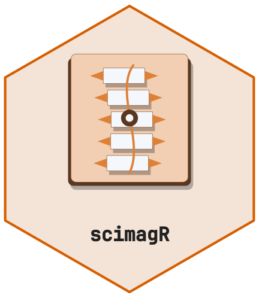

<!-- cttir-vignette-logo: start -->
<style>
.cttir-vignette-logo { float: right; width: 120px; max-width: 30%; margin: 0 0 1rem 1.5rem; }
.cttir-vignette-logo img { width: 100%; height: auto; border: 0; background: transparent; box-shadow: none; }
.cttir-vignette-logo .cttir-vignette-logo-light { display: block; }
.cttir-vignette-logo .cttir-vignette-logo-dark { display: none; }
@media (prefers-color-scheme: dark) {
  .cttir-vignette-logo .cttir-vignette-logo-light { display: none; }
  .cttir-vignette-logo .cttir-vignette-logo-dark { display: block; }
}
[data-bs-theme="light"] .cttir-vignette-logo .cttir-vignette-logo-light { display: block; }
[data-bs-theme="light"] .cttir-vignette-logo .cttir-vignette-logo-dark { display: none; }
[data-bs-theme="dark"] .cttir-vignette-logo .cttir-vignette-logo-light { display: none; }
[data-bs-theme="dark"] .cttir-vignette-logo .cttir-vignette-logo-dark { display: block; }
</style>
<div class="cttir-vignette-logo">
  
  
</div>
<!-- cttir-vignette-logo: end -->

<!-- badges: start -->
[](https://github.com/CTTIR/scimagR/actions/workflows/R-CMD-check.yaml)
[](https://cttir.github.io/scimagR/)
[](https://CRAN.R-project.org/package=scimagR)
[](https://app.codecov.io/gh/CTTIR/scimagR?branch=main)
[](https://cran.r-project.org/package=scimagR)
[](https://cran.r-project.org/package=scimagR)
[](https://opensource.org/licenses/MIT)
[](https://lifecycle.r-lib.org/articles/stages.html#experimental)
<!-- badges: end -->

```{r setup, include = FALSE}
knitr::opts_chunk$set(
  collapse = TRUE,
  comment = "#>",
  eval = FALSE
)
```

## Overview

scimagR provides R wrappers for the Spinal Cord Toolbox (SCT) command-line
tools. The code in this vignette is not run when the vignette is built,
because it needs SCT and your own images. The wrappers handle:

- Path resolution (respects the `SCT_DIR` environment variable)
- The command syntax of the installed SCT version: SCT 7.0 replaced
  `sct_deepseg -task <task>` with `sct_deepseg <task>` and renamed the
  tasks; the wrappers read the version from `sct_version` and use the
  matching form
- Input validation
- Idempotent execution (skip if the output exists)
- Structured error reporting: a failed command gives a warning with the end
  of its error output, and the wrapper returns `NA`; so does a command that
  exits normally without writing the expected file
- Optional QC report generation

## Configuration

Set the `SCT_DIR` environment variable if SCT is not on your PATH:

```{r sct-dir}
Sys.setenv(SCT_DIR = "/path/to/sct")
```

Or add it to your `.Renviron`:

```
SCT_DIR=/path/to/sct
```

## Spinal Cord Segmentation

The contrast-agnostic model (`sct_deepseg spinalcord`):

```{r segment-sc}
library(scimagR)

sc_seg <- sct_segment_sc(
  input = "sub-01_T2w.nii.gz",
  qc_dir = "qc/"
)
# "sub-01_T2w_seg.nii.gz"
```

## Lesion Segmentation (SCIsegV2)

SCIsegV2 (`sct_deepseg lesion_sci_t2`) segments the lesion and the spinal
cord. The lesion mask is returned; the cord mask is saved next to it as
`*_sc_seg.nii.gz`:

```{r segment-lesion}
lesion_seg <- sct_segment_lesion(
  input = "sub-01_T2w.nii.gz",
  qc_dir = "qc/"
)
# "sub-01_T2w_lesion_seg.nii.gz" (and "sub-01_T2w_sc_seg.nii.gz")
```

## Vertebral Labelling

`sct_label_vertebrae` names its outputs after the segmentation. The wrapper
returns the labelled segmentation (`*_seg_labeled.nii.gz`), the file that
`sct_process_segmentation()` needs; the disc labels are written next to it
(`*_seg_labeled_discs.nii.gz`).

```{r label-vert}
vert_labels <- sct_label_vertebrae(
  input = "sub-01_T2w.nii.gz",
  segmentation = sc_seg
)
# "sub-01_T2w_seg_labeled.nii.gz"
```

## Parameter Extraction

```{r analyze}
# Lesion parameters (volume, length, tissue bridges): an Excel spreadsheet,
# *_analysis.xlsx (*_analysis.xls with SCT 6.4)
lesion_xlsx <- sct_analyze_lesion(
  lesion_seg = lesion_seg,
  sc_seg = "sub-01_T2w_sc_seg.nii.gz"
)

# Morphometric parameters (CSA, diameters), averaged over C2-C7 and
# reported per vertebral level
csa_csv <- sct_process_segmentation(
  sc_seg = sc_seg,
  vert_labels = vert_labels,
  vert = 2:7,
  perlevel = TRUE
)
```

Without `vert`, `sct_process_segmentation()` averages the metrics over all
slices of the segmentation, and the `VertLevel` column of the CSV is empty.

## QC Reports

The segmentation wrappers write QC reports when given `qc_dir`. To make a
report afterwards, use `sct_generate_qc()`:

```{r qc}
# Spinal cord segmentation
sct_generate_qc(
  input = "sub-01_T2w.nii.gz",
  segmentation = sc_seg,
  qc_dir = "qc/"
)

# Lesion: the cord mask as `segmentation`, the lesion mask as `lesion`
sct_generate_qc(
  input = "sub-01_T2w.nii.gz",
  segmentation = "sub-01_T2w_sc_seg.nii.gz",
  lesion = lesion_seg,
  qc_dir = "qc/",
  process = "sct_deepseg_lesion",
  plane = "sagittal"
)
```

## Idempotent Execution

All SCT wrappers that write images are idempotent by default. If the output
file already exists, the function returns the existing path without
re-running:

```{r idempotent}
# First call: runs segmentation
sct_segment_sc("sub-01_T2w.nii.gz")

# Second call: skips, returns existing path
sct_segment_sc("sub-01_T2w.nii.gz")

# Force re-run:
sct_segment_sc("sub-01_T2w.nii.gz", overwrite = TRUE)
```

## Troubleshooting

Common issues:

- **"Cannot find sct_deepseg on PATH"**: Set `SCT_DIR` or add SCT `bin/` to
  PATH
- **A wrapper returns `NA`**: read the warning; it shows the exit code and
  the last lines of the SCT error output, or names the output file SCT did
  not write
- **Python errors**: Ensure the correct Python environment is activated
